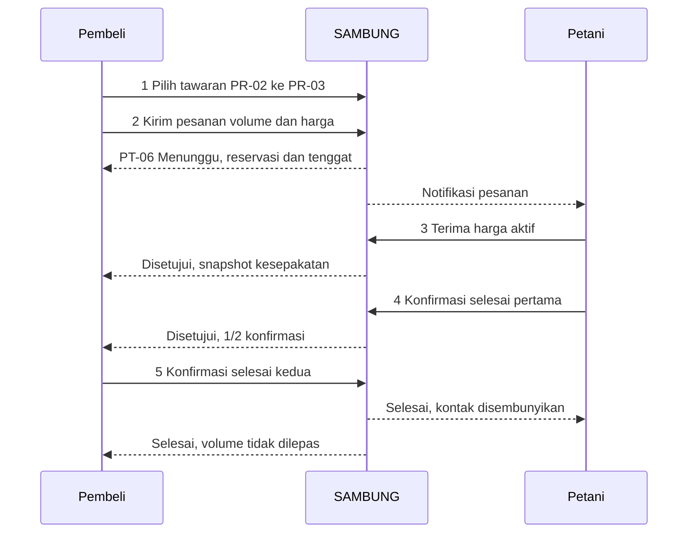

# SAMBUNG — Implementation-ready UI Design Specification

| Metadata | Nilai |
|---|---|
| Versi / tanggal | 1.0 · 7 November 2026 |
| Jenis keluaran | Dokumen handoff desain web responsif; bukan implementasi aplikasi |
| Baseline kebutuhan | SRS v0.2 dan IA v0.2, disetujui sebagai pasangan baseline fase 2 |
| Status dokumen ini | Usulan rincian desain untuk review; tidak mengubah status persetujuan sumber |
| Cakupan | 32 identitas IA: 31 halaman/detail dan satu panel ekspor PR-07 |
| Pembaca | Designer, frontend developer, backend developer, tim data, dan QA |
| Skill | ui-designer; eksplorasi keputusan memakai brainstorming; verifikasi dokumen sebelum handoff |

## 1. Dasar desain dan cara memakai

### 1.1 Sumber dan kewenangan

Semua tautan sumber berikut relatif terhadap dokumen ini.

| Sumber | Peran dalam handoff |
|---|---|
| [SRS_SAMBUNG.md](../../../docs/source_of_truth/SRS_SAMBUNG.md) | Otoritas perilaku, FR-001–031, BR-001–020, AC-001–036, NFR dan OPN |
| [IA_SAMBUNG.md](../../../docs/source_of_truth/IA_SAMBUNG.md) | Identitas halaman, akses peran, alur dan keadaan K0–K7 |
| [UI_GUIDELINES_SAMBUNG.md](../../../docs/source_of_truth/UI_GUIDELINES_SAMBUNG.md) | Acuan visual v0.2, masih untuk review; keputusan pengguna yang dikutip tetap mengikat |
| [Manifest token](../../../docs/source_of_truth/assets/sambung-tokens.json) / [kontrak CSS](../../../docs/source_of_truth/assets/sambung-theme.css) | Sumber nilai warna, alias dan integrasi tema |
| [Glosarium](../../../docs/source_of_truth/GLOSSARY.md) / [matriks sumber](../../../docs/source_of_truth/traceability-matrix.md) | Istilah dan jejak keputusan asli |
| [Role Panel Content Spec](../../../docs/source_of_truth/ROLE_PANEL_CONTENT_SPEC.md) | Referensi hierarki panel; hanya dipakai bila konsisten dengan SRS/IA |

Jika terdapat konflik, keputusan pengguna terbaru yang tercatat mengatasi default lama; SRS mengatur perilaku, IA mengatur penempatan, guideline mengatur visual. Dokumen ini memberi rincian penyajian, bukan izin bisnis baru. Role Panel Spec masih memakai beberapa istilah lama: “Produsen” sebagai ruang kerja diganti **Pembeli**; “Tawaran Saya” pembeli menjadi **Pesanan/Kontrak**; moderasi tidak menjadi gerbang persetujuan terbit. Tidak menjanjikan estimasi lama peninjauan yang belum diputuskan.

Label **baseline** berarti diturunkan dari SRS/IA; **keputusan desain** berarti pilihan penyajian penulis yang dapat direview; **dependensi OPN** berarti fakta/kebijakan belum lengkap. Seluruh angka contoh adalah fixture ilustrasi, bukan harga pasar atau hasil model terkini.

Developer membaca §2–5 terlebih dahulu, lalu kartu halaman §6–10, aturan transaksi §11 dan kontrak data §12. QA memakai §14 dan matriks §15. Setiap halaman mewarisi keadaan dan aksesibilitas bersama; baris halaman menambahkan rincian khusus, sehingga aturan bersama tidak perlu disalin 32 kali.

### 1.2 Tujuan, batas dan pendekatan

Tujuan: petani memahami acuan dan volume yang masih dapat ditawarkan; pembeli memilih pasokan deklaratif dan mengajukan pesanan; kedua pihak menyelesaikan kesepakatan simulasi; Admin menjaga kualitas data tanpa bertindak sebagai pihak kontrak. Informasi publik tetap dapat dibaca tanpa login.

Pendekatan yang dipilih penulis adalah **satu spesifikasi menyeluruh per halaman dengan komponen domain bersama**. Dokumen guideline saja belum cukup untuk menjelaskan field, aksi dan konflik; paket mockup saja belum cukup untuk menjelaskan otorisasi dan perubahan versi. Kedua pendekatan tersebut dipakai sebagai referensi pendukung, sementara handoff ini menjadi peta penerapan keduanya. Permintaan pengguna sudah memilih keluaran dokumen, sehingga tidak ada kode produk, instalasi, atau perubahan source of truth dalam pekerjaan ini.

Non-goal: pembayaran, logistik, tanda tangan tersertifikasi, verifikasi mutu fisik, perpindahan peran, ruang kerja Pendamping/Dinas, alert lonjakan otomatis, offline/PWA, retraining otomatis, dan backend/provider baru. Jangan menambah fitur tersebut melalui tombol atau mockup.

### 1.3 Konsep visual

**Layanan pertanian modern yang tenang dan mudah dibaca.** Canvas netral, panel putih/gelap dengan border tipis, Forest Green sebagai aksi utama, angka tabular yang jelas, dan divider untuk rincian. Ciri khasnya adalah satu blok harga yang menyatukan jenis gabah, acuan, posisi harga dan alasan; serta ringkasan volume yang memisahkan tersedia, reservasi, Disetujui dan Selesai.

Judul konkret, ikon outline Lucide, tanpa emoji dalam produk. Hindari kartu bersarang, angka dekoratif, hero pada halaman transaksi, gradien, parallax atau animasi angka harga. Foto bukan dependensi alur. Label SIMULASI selalu hadir di konteks pesanan/kontrak/bukti.

## 2. Sistem visual

### 2.1 Warna dan mode

Nilai canonical lengkap tetap pada manifest; tabel ini adalah subset implementasi. Gunakan token semantik, bukan HEX berbeda pada setiap komponen.

| Token / penggunaan | Light | Dark |
|---|---|---|
| background / foreground | `oklch(1 0 0)` / `oklch(0.145 0 0)` | `oklch(0.145 0 0)` / `oklch(0.985 0 0)` |
| card / card-foreground | `oklch(1 0 0)` / `oklch(0.145 0 0)` | `oklch(0.205 0 0)` / `oklch(0.985 0 0)` |
| canvas = muted | `oklch(0.97 0 0)` | `oklch(0.269 0 0)` |
| primary / primary-foreground | `#3E5A3A` / putih | `#B7D2A5` / `oklch(0.145 0 0)` |
| primary-hover | `#31492F` | `#C7DEB8` |
| input / ring | `#7A7A7A` / `#3E5A3A` | `#8C8C8C` / `#B7D2A5` |
| sidebar / foreground | `oklch(0.985 0 0)` / teks utama | `oklch(0.205 0 0)` / teks utama |
| sidebar-accent / foreground | `#EAF1E7` / `#3E5A3A` | `#2B3826` / `#B7D2A5` |
| price-within / surface | `#246447` / `#E8F2E4` | `#A9D6B0` / `#203E2B` |
| price-caution / surface | `#775000` / `#FFF0C2` | `#FFD55A` / `#453819` |
| price-low / surface | `#9B3529` / `#FBE5DD` | `#FFC0AB` / `#4A2922` |
| review / surface | `#7A4B21` / `#FFF0D2` | `#E9C78D` / `#3F3220` |
| destructive / foreground | `#9B3529` / putih | `#F1AA8C` / `#311A12` |
| contract / contract-surface | Alias `secondary-foreground` / `secondary` | Alias yang sama pada mode gelap |

Sunflower `#FFD55A`, Honey `#F4A62A`, Olive `#8A9A3A`, Terracotta `#C86B3C`, Cream `#FFF3D6` hanya aksen terbatas sesuai guideline. Cream bukan latar aplikasi. `accent` shadcn tetap hover netral. `muted-foreground` hanya di permukaan yang disahkan audit; subjudul di canvas memakai foreground. Border dekoratif tidak menggantikan batas input solid.

Status kontrak memakai badge netral dengan label; lampu harga memakai ikon + teks + alasan; moderasi memakai label “Sedang diminta perbaikan”. Ketiganya tidak saling menggantikan. Mode gelap mengubah token, bukan data, izin atau makna status. Keputusan desain: ikuti sistem saat belum ada pilihan; pilihan eksplisit disimpan pada perangkat bila tersedia. Kegagalan penyimpanan tidak menghalangi tugas.

### 2.2 Tipografi, angka dan satuan

| Peran | Font / bobot | Ukuran / line-height |
|---|---|---|
| Hero publik | Plus Jakarta Sans 700 | 42–68 px / 1,10; mengecil dan membungkus pada mobile |
| H1 ruang kerja | Plus Jakarta Sans 700 | 28 px mobile, 32 px desktop / 1,20 |
| H2 seksi | Plus Jakarta Sans 700 | 26–32 px / 1,25 |
| Judul panel | Plus Jakarta Sans 600 | 21 px / 1,35 |
| Judul dialog | Plus Jakarta Sans 600 | 26 px / 1,30 |
| Isi / input / label / tombol | Atkinson Hyperlegible Next 400 / 600 | 16 px / 1,50 |
| Harga utama | Atkinson Hyperlegible Next 600, tabular | 32–42 px / 1,20; satuan 16 px |
| Angka tabel | Atkinson Hyperlegible Next 400 / 600, tabular | 16 px / 1,50, rata kanan |
| Metadata sekunder / badge | Atkinson Hyperlegible Next 400 / 600 | 14 px / 1,50; bukan instruksi atau status penting satu-satunya |

Fallback sans-serif tetap terbaca saat font gagal. Lisensi font dan berkas aktual diverifikasi saat integrasi; deklarasi tabular belum membuktikan fitur font terpasang. Heading mengikuti hierarki dokumen, bukan dipilih semata karena ukuran.

Gunakan formatter `id-ID` bersama: `Rp7.000/kg`, `125,50 kg`, `−16,67% dari median`. Label tanggal wajib menjelaskan waktu sumber, waktu hitung atau tenggat. Tenggat menyertakan zona waktu eksplisit; keputusan desain awal tampilan WIB, dengan timestamp server sebagai otoritas. Nilai kosong berupa teks “Belum tersedia”, bukan `0`. Mutu kosong “Belum diukur”, tanggal kosong “Belum ditentukan”. Harga input rupiah bulat; volume maksimal dua desimal; presisi berlebih ditolak. Pembulatan L/U ke rupiah terdekat dengan 0,5 ke atas; angka yang dinilai sama dengan angka batas yang terlihat.

### 2.3 Dimensi, grid dan motion

| Elemen | Spesifikasi |
|---|---|
| Skala spacing | 4, 8, 12, 16, 24, 32, 48, 64 px |
| app-wrap | Maksimum 1.216 px, terpusat dalam area konten setelah sidebar; tidak memaksa lebar minimum |
| Padding luar | 16 px <1.024 px; 24 px desktop; gap antarpanel 24 px |
| Padding panel | 16 px mobile, 24 px desktop |
| Grid desktop | 12 kolom, gutter 24 px; pasangan panel 8:4 atau form 7:5 |
| Radius | sm 4, md 6, lg 8, xl 12 px; input md, tombol lg, panel/dialog xl |
| Header / sidebar | Desktop 72 px / 208 px; mobile header minimal 64 px dan tumbuh saat label membungkus |
| Kontrol | Min-height 44 px, target min-width 44 px; tombol padding horizontal 16 px; label boleh membungkus |
| Ikon | Outline 20 px; ikon interaktif tetap target 44×44 px |
| Divider / elevasi | Border 1 px dekoratif; kartu tanpa shadow; overlay memakai satu token shadow bersama yang dipilih builder |
| Gerak | Transisi warna/opacity 120–150 ms; reduced-motion tanpa perpindahan/animasi; konten selalu tersedia |

Breakpoint: <640 px satu kolom; 640–1.023 px ringkasan dua kolom bila cukup; ≥1.024 px sidebar permanen dan grid desktop. Semua panel punya lebar `min(100%, available)`; child grid dapat menyusut. Form tunggal maksimum 672 px; form dengan panel harga memakai grid 7:5. Hentikan sticky header/sidebar/action bar pada zoom/tinggi pendek jika menutupi fokus. Action bar default berada di alur akhir konten; bukan footer fixed yang menutupi field.

## 3. Shell, navigasi dan identitas halaman

### 3.1 Shell bersama

Urutan DOM: skip link → header → navigasi → breadcrumb → H1 + penjelasan → status menetap → filter/panel → action bar. Satu `main`, satu H1; fokus awal setelah navigasi ke H1, bukan langsung ke tombol mutasi. Kembali ke daftar memulihkan filter dan posisi scroll bila objek masih tersedia. Filter nonpribadi dapat disimpan di query/state navigasi; nomor HP, OTP, alasan bebas dan data privat tidak masuk URL.

Desktop: header identitas kiri, konteks wilayah, mode, notifikasi dan akun di kanan; sidebar di bawah header. Publik memakai tautan navigasi horizontal saat muat dan menu Sheet saat sempit. Sheet ruang kerja berlabel “Menu”, fokus terperangkap saat terbuka, Escape menutup dan fokus kembali ke pemicu. Akun menunjukkan satu peran; tidak ada role switcher produk. Kontrol demo prototipe tidak menjadi desain autentikasi final.

| Ruang | Tujuan utama | Pendukung |
|---|---|---|
| Publik | Beranda, Papan Harga, Peta, Prakiraan | Bantuan/Privasi/Syarat, Masuk/Daftar, Masuk Admin, mode |
| Petani | Beranda, Tawaran Saya, Pesanan/Kontrak | Jual Hasil Panen, harga/prakiraan publik, notifikasi, profil |
| Pembeli | Dasbor, Katalog Pasokan, Pesanan/Kontrak | Harga/prakiraan publik, ekspor agregat, notifikasi, profil |
| Admin | Ringkasan, Parameter, Data Harga, Moderasi, Pengguna, Log Audit, Model dan Evaluasi | Baca informasi publik dan kontrak pemantauan; keluar |

Pemilih wilayah konteks harga bukan pembatas transaksi nasional dan tidak mengubah lokasi profil/tawaran. Akses halaman publik dari ruang kerja mempertahankan sesi serta jalan kembali. Tidak menampilkan menu yang tidak diizinkan; server tetap menolak URL/respons/ekspor terlarang. Sesi habis: minta login, pulihkan tujuan hanya setelah izin diperiksa ulang, jangan mengirim mutasi secara otomatis.

### 3.2 Alias dan kontrak navigasi

ID IA adalah identitas desain, bukan kewajiban pola URL. Builder boleh memilih router/route tanpa mengubah hak akses. PT-08 → PB-04; PR-04 → PT-05; PR-05 → PT-05/PT-06/PT-06a; PR-06 → PT-07/PB-04; PR-08 → PT-09/PT-10. Semua menggunakan objek yang sama. PR-07 adalah panel dari PR-01/02; PB-03b dapat berupa detail pada shell yang sama tetapi harus bisa dipulihkan dari pilihan provinsi. Tidak ada AD-08 transaksi nyata.

## 4. Kontrak keadaan dan umpan balik

Setiap kartu halaman di bawah mewarisi tabel ini untuk region yang relevan. Sukses bukan keadaan kontrak baru: tampilkan hasil server pada halaman, dengan pesan pendamping.

| Kode | Trigger dan tampilan | Kontrol / fokus / pemulihan |
|---|---|---|
| K0 Normal | Data tervalidasi + konten dan izin halaman | Aksi sesuai tabel status; tidak menunggu animasi |
| K1 Memuat | Skeleton bentuk konten atau teks “Memuat…”; region `aria-busy` | Tidak menampilkan angka 0 palsu; mutasi pada data belum diketahui nonaktif dengan alasan |
| K2 Kosong | Judul, penyebab dan satu langkah sah | Bedakan belum ada data dengan filter tidak cocok; reset filter hanya kasus kedua |
| K3 Gagal / hasil belum pasti | Alert inline menetap, isian tetap; pisahkan gagal pasti dari respons mutasi hilang | Read retry boleh; mutasi ambigu rekonsiliasi ID permintaan sebelum retry; fokus ke pesan/ringkasan galat |
| K4 Sesi/izin/objek tidak tersedia | Publik diminta login; akun tak berhak mendapat pesan generik “Halaman tidak dapat diakses” | Jangan bocorkan judul, pihak, kontak atau keberadaan detail privat; tautan ke beranda sah |
| K5 Usang / tidak cukup | Sumber/periode/umur sebenarnya; alasan belum tersedia | Tidak menciptakan angka/lampu. Penerbitan/pesanan tetap boleh bila acuan hilang dan syarat bisnis lain terpenuhi |
| K6 Konflik versi / stok / status | Nilai terbaru dan apa yang berubah | Pertahankan input pengguna untuk perbandingan; minta tinjau ulang, reset persetujuan harga terkait; tidak auto-submit |
| K7 Dependensi belum tersedia | Penjelasan fitur belum siap dan rujukan internal OPN di spesifikasi | Hanya aksi yang bergantung pada OPN ditahan; kode OPN tidak menjadi jargon dalam produk |

K3 tidak berarti pesanan batal; pending tidak berarti sukses. Umpan balik sukses di halaman bertahan bersama nomor/status; toast opsional sekunder. Toast gagal tidak menggantikan alert transaksi. Error field ditempel dekat input dan dihubungkan melalui deskripsi; bila banyak, ringkasan di atas form memuat tautan field. Validasi saat blur atau submit, bukan alarm setiap ketukan. Saat request pending, cegah klik berulang pada aksi yang sama, tampilkan label “Mengirim…”, pertahankan konteks.

Data K5 usang tidak otomatis ditentukan oleh umur buatan frontend: kebijakan kecukupan/umur berasal OPN-002. Peta/grafik punya pemuatan data terpisah dari geometri/render, sehingga kegagalan peta tetap memberi tabel data bila tersedia.

## 5. Inventaris komponen

Ukuran minimum kontrol di §2 berlaku juga untuk varian compact. Semua komponen data menerima keadaan K yang relevan, bukan angka dummy. Nama berikut adalah kontrak konseptual, bukan kewajiban nama berkas baru.

| ID / komponen | Jenis / ukuran | State dan kontrak | Dipakai |
|---|---|---|---|
| C01 AppShell | Header/sidebar/Sheet §3 | Peran, mode, sesi; active link berlabel dan `aria-current` | Semua |
| C02 PageHeader | Breadcrumb + H1; gap 8/16 px | Loading identitas tidak membocorkan objek; satu CTA dominan | Semua |
| C03 ActionButton | Primary/outline/ghost/destructive; ≥44 px | Default, hover, focus, pressed, disabled, pending; alasan nonaktif terlihat | Semua |
| C04 FormField | Label, input/select/textarea, unit; gap 8 px | Required/optional eksplisit, invalid, readonly, pending; nilai mentah dipertahankan | Form |
| C05 FilterBar | Grid 3 kolom desktop, stack mobile | Nilai diterapkan, reset, loading; label hasil/filter aktif | PB/daftar |
| C06 PriceReference | Panel penuh; harga 32–42 px | L/U, jenis, wilayah, sumber/periode, umur, versi, ketersediaan | PT/PR/PB |
| C07 PriceInputWithZones | Input angka + slider + marker L/U | Merah–kuning–hijau–kuning, alasan, unavailable tanpa zona; sinkron input/range | PT-02/PR-03/PT-06 |
| C08 PriceLamp | Ikon+label 16 px+alasan | Within/caution-below/caution-above/low/unavailable; bukan status kontrak | Harga |
| C09 PriceAcknowledgement | Checkbox target 44 px + teks 16 px | Unchecked awal; identitas harga/versi/acuan; reset saat konteks berubah | Mutasi harga merah |
| C10 OfferRow | Panel 16/24 px; daftar berdivider alternatif | Jenis/lokasi/tersedia/total/harga/mutu/status; klik detail semantik | PT-03/PR-02 |
| C11 VolumeBreakdown | Definition list atau bar berlabel | Total, tersedia, reservasi, Disetujui, Selesai; tidak hanya warna | Tawaran/kontrak |
| C12 ContractStatus | Badge netral + progress terpisah | Enam status resmi; konfirmasi selesai 0/2, 1/2, 2/2 | PT-05/06 |
| C13 ContractTimeline | Daftar vertikal; tanggal/pelaku/versi | Harga aktif berbeda riwayat; alasan akhir; akses data per peran | PT-06/AD-06 |
| C14 ReasonDialog | Maks 560 px; mobile lebar viewport−32 px | Tolak/batal: alasan wajib, dampak, pending/error; bukan satu dialog generik tanpa konteks | PT-06 |
| C15 ImpactConfirm | Maks 560 px; tinggi fleksibel | Penarikan, penyelesaian, penutupan; rincian objek dan dampak aktual | PT-04/06/10 |
| C16 DataChart | Lebar penuh; plot usulan 280 px, boleh tumbuh | Observasi solid/model putus/baseline titik; interval + nilai; tabel ekuivalen | PB-02/04 |
| C17 ProvinceMap | Lebar penuh; tinggi usulan 420 desktop/300 mobile | Skala signed, selected, missing pattern, tabel setara; tidak hanya hover | PB-03 |
| C18 ReviewNotice | Alert ringkas, teks 16 px | Terbuka/Menunggu Peninjauan tetap tampak; catatan pembeli terpisah internal | PT-04/PR/AD-04 |
| C19 StateRegion | Skeleton/empty/error/unavailable | K1–K7, CTA sah, aria-live seperlunya | Semua |
| C20 ExportSupplyPanel | Dialog/Sheet max 672 px | Filter/grup/preview/snapshot, unduh pending/error/empty | PR-07 |
| C21 ParameterDiff | Dua kolom sebelum/sesudah; mobile pasangan baris | Versi dan dampak; konflik wajib tinjau ulang | AD-02 |
| C22 EvaluationGate | Tabel per provinsi × horizon | Model/baseline/tidak tersedia, bukti dan alasan, tidak ada lulus global semu | AD-07 |
| C23 ConsentBlock | Tautan dokumen + checkbox 44 px | Versi tersedia, unchecked, error, pending; tidak diwakili OTP | AU-03 |
| C24 SimulationReceipt | Dokumen cetak A4, margin usulan 15 mm | SIMULASI tiap halaman cetak, sumber snapshot, privasi terkini | PT-06a |

Gunakan primitive shadcn/ui yang sesuai basis terpasang untuk Dialog/AlertDialog/Sheet/Select dan kontrol. Prototipe mencantumkan Radix, tetapi pemilihan generator/API lengkap harus diperiksa saat integrasi; jangan mencampur `asChild` dan `render` antar basis. Adapter toast satu jalur. Penentuan paket chart/map tidak menjadi keputusan kebutuhan baru.

## 6. Spesifikasi halaman publik

Notasi layout menunjukkan urutan baca, bukan ukuran tetap. Semua halaman memakai C01/C02/C19 dan K0–K7 yang relevan. “Baca” di sini tidak memberi akses katalog privat.

### PB-01 — Beranda publik

**Tujuan/aktor:** pengunjung memahami manfaat dan membuka informasi harga; semua peran boleh baca. **Rujukan:** FR-002/005/011/012/015/030; AC-002/005/015/030.

**Desktop:** hero pendek + CTA → ringkasan harga dan sumber → jalur Petani/Pembeli → akses peta/prakiraan/bantuan. Maksimal empat panel utama dalam viewport; jangan menjejalkan seluruh modul di atas lipatan. **Mobile:** judul → CTA “Lihat Papan Harga” → ringkasan → jalur peran → informasi pendukung. Hero tidak bergantung foto.

Konten P0: manfaat membandingkan harga gabah, pemberitahuan “Kesepakatan di SAMBUNG merupakan simulasi”, ringkasan berjenis/wilayah/periode. CTA primer ke PB-02; peta PB-03, prakiraan PB-04, masuk AU-01 dan Admin AU-04 sebagai tautan sekunder. Cek harga cepat dari panel spec tidak ditambahkan sebagai fitur terpisah; tautkan ke acuan PT-07 dengan konteks yang tersedia.

K5 ringkasan kosong menampilkan alasan tanpa memblokir navigasi; K3 satu sumber gagal tidak menjadikan seluruh beranda error. Tidak ada angka pengguna/hasil model/katalog fiktif.

### PB-02 — Papan Harga

**Tujuan/aktor:** membandingkan rantai harga setara; publik. **Rujukan:** FR-011/018/030; BR-016; AC-011/018/030.

**Desktop:** H1 → C05 jenis/pasar/wilayah/periode → grid 8:4 rantai harga + ringkasan bagian petani → grafik histori penuh → sumber/metode. **Mobile:** filter → rantai → ringkasan → grafik/tabel. Harga sejajar dan satuan dekat angka.

Rantai berisi pengamatan gabah petani, ekuivalen beras berlabel konversi, produsen tingkat pasar dan eceran; pedagang besar hanya jika tersedia. Estimasi wajar ditempatkan sebagai blok terpisah, bukan disisipkan sebagai observasi. Tiap nilai memiliki source/periode/frekuensi. Tampilkan bagian petani hanya bila penyebut positif dan pembanding setara; jika tidak, “Belum dapat dibandingkan” + sebab, bukan 0%.

Aksi utama konteks data “Unduh CSV Harga”; tautan “Lihat Acuan” PT-07 dan “Buka Prakiraan” PB-04 membawa filter yang kompatibel. K5 beda periode/frekuensi tidak dipaksakan menjadi satu persentase. Filter berubah menandai loading dan mengganti seluruh ringkasan terkait secara konsisten.

### PB-03 — Peta

**Tujuan/aktor:** melihat harga provinsi terhadap median; publik. **Rujukan:** FR-012/029/030; BR-017; AC-012/029/030.

**Layout:** H1 → filter komoditas/pasar/periode → peta penuh → legenda signed → ringkasan cakupan/min/maks/disparitas → tautan penjelasan. “Tampilkan Tabel Provinsi” PB-03a selalu terlihat di atas peta. Pilihan provinsi membuka PB-03b, bukan tooltip hover saja.

Selisih `(harga−median)/median×100%`, dengan provinsi valid dan pembanding positif. Skala kontinu berpusat 0%: map-low → map-mid → map-high; tampilkan nilai minimum, 0 dan maksimum serta “Lebih murah / Lebih mahal”. Keputusan desain: domain warna simetris `−M…+M`, M=max nilai absolut pada snapshot/filter; bila semua 0, tampilkan tengah dan legenda “Semua harga sama dengan median”. Tidak menambah kategori A–D. Provinsi tanpa data berpattern diagonal dan label; bukan nilai tengah. Tabel memberikan angka persis. Minimum dua provinsi valid untuk perbandingan antarwilayah yang informatif; jika hanya satu, tampilkan harga dan keterbatasan cakupan tanpa klaim disparitas antarwilayah.

K3 geometri gagal: jelaskan kegagalan render dan arahkan tabel bila data valid. K5 median/denominator tidak valid: jangan hitung persentase. Sumber/lisensi/pemetaan GeoJSON mengikuti OPN-009; bentuk pulau dekoratif tidak boleh diperlakukan batas administratif.

### PB-03a — Tabel Provinsi

**Tujuan/aktor:** alternatif penuh peta; publik. **Rujukan:** FR-012; AC-012.

H1 → filter yang sama → tabel nama provinsi/harga/selisih signed/arah/status data → metadata cakupan. Default nama provinsi A–Z (keputusan desain). Sort nama/harga/selisih diberi label urutan; missing ditempatkan terakhir saat sort numerik. Mobile gunakan baris nama → harga → arah dan angka, bukan menghilangkan selisih. Pilih provinsi ke PB-03b; “Kembali ke Peta” mempertahankan filter/himpunan pembanding. K2/K5 memakai himpunan yang sama dengan PB-03; sort tidak menghitung median baru.

### PB-03b — Detail Provinsi

**Tujuan/aktor:** membaca konteks harga dan penjelasan wilayah; publik. **Rujukan:** FR-012/029; BR-014/017; AC-012/029.

H1 provinsi → harga/satuan/periode + selisih terhadap median → sumber/cakupan → penjelasan model dan keterbatasan → tautan lanjutan. Desktop dua kolom 8:4 untuk rincian dan ringkasan; mobile urutan sama. CTA “Lihat Rantai Harga” PB-02; sekunder PB-04/PB-03. Faktor SHAP menyebut model/versi/target/periode dan arah kontribusi, bukan penyebab pasti. Bila perbandingan prediksi, label sebagai prediksi. K5 SHAP hilang menampilkan “Penjelasan model belum tersedia”; harga valid tetap terlihat. Perubahan periode membersihkan penjelasan lama sebelum respons baru tampil.

### PB-04 — Prakiraan dan Penjelasan

**Tujuan/aktor:** membaca prakiraan beras produsen dan turunan gabah; publik. **Rujukan:** FR-015/016/030/031; BR-013/014/015; AC-015/016/030/031.

H1 → pilih provinsi + horizon radio 2/4 pekan → hasil utama beras → hasil turunan GKP/GKG → grafik/tabel → faktor model → metode/evaluasi. Desktop grafik 8 kolom dan ringkasan 4; mobile ringkasan penting mendahului plot. Tiap hasil menyebut waktu terbit, cutoff/target periode, metode/versi, sumber dan status evaluasi. Harga turunan berlabel “Estimasi turunan”, tidak mewarisi klaim akurasi beras.

Pita 80% hanya jika valid; nilai batas tersedia dalam teks/tabel. Model belum layak → baseline terevaluasi, berlabel “Prakiraan baseline” dengan alasan; baseline/interval tidak valid → belum tersedia untuk unit tersebut. SHAP hanya untuk model/keluaran yang cocok; baseline tidak mengambil SHAP kandidat lain. CTA “Lihat Detail Acuan” PT-07; histori PB-02. K5 satu horizon/provinsi gagal tidak membuat unit lain otomatis gagal/lulus.

### PB-05 — Bantuan, Privasi dan Syarat

**Tujuan/aktor:** memahami layanan dan kebijakan; publik. **Rujukan:** FR-002; BR-001/010/018/020; AC-002.

H1 → navigasi bagian Bantuan/Privasi/Syarat → konten lebar baca 45–70 karakter → versi/status dokumen dan kontak pengelola yang benar-benar tersedia. Jelaskan GKP/GKG, mutu deklaratif, rentang/lampu, horizon, simulasi, kontak hanya saat Disetujui, lima tindakan beserta pengecualian. Tautan dari consent menuju versi dokumen yang ditampilkan, dengan jalan kembali ke AU-03 tanpa kehilangan isian.

K7 kebijakan belum tervalidasi diberi status review; jangan mengarang masa retensi, SLA penghapusan, atau klaim kepatuhan. Pendaftaran produksi yang membutuhkan dokumen kebijakan disahkan tetap bergantung OPN-004. Informasi bantuan umum tetap dapat dibaca.

## 7. Spesifikasi autentikasi

Semua memakai satu panel maksimum 480 px, terpusat horizontal, padding 24/16 px, judul dan label tetap terlihat. Pada mobile align dekat atas agar keyboard tidak menutup tombol. Tidak ada sidebar kerja sebelum akun berhak.

### AU-01 — Masuk / Daftar

**Tujuan/aktor:** mulai verifikasi akun biasa; pengunjung tanpa sesi. **Rujukan:** FR-001/002; AC-001/002.

Urutan: judul → nomor HP berlabel dengan contoh format → pemberitahuan pemrosesan data + tautan → “Kirim Kode” → bantuan. `inputmode=tel`, jangan memotong kode negara atau mengubah nomor ambigu diam-diam; normalisasi mengikuti kontrak provider. Kirim valid ke AU-02 dengan tujuan tersamar. K3 provider gagal mempertahankan input dan belum menyatakan kode terkirim. K7 konfigurasi provider belum tersedia: tombol tidak berpura-pura berhasil; kode demo statis bukan fallback produksi.

### AU-02 — Verifikasi OTP

**Tujuan/aktor:** buktikan akses nomor; pemohon challenge. **Rujukan:** FR-001; AC-001.

Tujuan tersamar → satu input kode logis yang mendukung paste/autofill → “Verifikasi” → “Ubah Nomor” → status/kirim ulang. Panjang kode, expiresAt, resendAt dan batas percobaan berasal konfigurasi server OPN-001, bukan asumsi enam digit/60 detik. Kode salah, kedaluwarsa, rate limit dan layanan gagal punya pesan terpisah tanpa membocorkan keberadaan akun. Sesi hanya setelah verifikasi valid; akun lama ke ruang sesuai peran, akun baru ke AU-03 sebagai onboarding yang belum selesai. Countdown bukan otoritas server.

### AU-03 — Peran dan Profil Akun Baru

**Tujuan/aktor:** menyelesaikan profil akun biasa setelah nomor terverifikasi. **Rujukan:** FR-001/002/027; BR-018; AC-001/002/027.

Pilihan radio Petani/Pembeli → nama → wilayah berjenjang → kelompok/usaha bila relevan → C23 persetujuan → “Buat Akun”. Teks pilihan peran menjelaskan kemampuan dan bahwa pergantian peran tidak tersedia pada MVP. Tidak ada Admin atau multi-peran. Checkbox tidak tercentang awal; dokumen bisa dibaca sebelum memilih. Simpan versi yang dilihat + waktu persetujuan server. Tanpa persetujuan tidak membuat akun/sesi akun lengkap. K3 isian tetap; bila versi kebijakan berubah sebelum submit, tampilkan dokumen baru dan minta consent baru, bukan meneruskan centang lama. K7 isi kebijakan belum disahkan tidak diganti boilerplate yang dianggap sah.

### AU-04 — Masuk Admin

**Tujuan/aktor:** akses Admin yang disediakan pengelola. **Rujukan:** FR-028; AC-028.

Email → sandi dengan tombol tampil/sembunyikan berlabel → “Masuk Admin” → kembali publik. Dukung password manager; salah kredensial pesan generik tanpa mengungkap akun valid. K3/K4 tidak memberi sesi. Tidak ada daftar Admin. Recovery hanya ditampilkan jika mekanismenya disahkan pada OPN-001; jangan membuat tautan mati.

## 8. Spesifikasi petani dan halaman bersama

### PT-01 — Beranda Petani

**Tujuan/aktor:** menentukan langkah penjualan berikutnya; petani sendiri. **Rujukan:** FR-003/005/015/017; AC-003/005/015/017.

Desktop: header + “Jual Hasil Panen” → acuan GKP/GKG lebar → ringkasan volume/aktivitas → grid 8:4 tawaran/pesanan terbaru + prakiraan/tindak lanjut. Mobile: CTA → pesanan perlu respons → acuan → tawaran → prakiraan. Ringkasan tersedia/reservasi/Disetujui/Selesai tidak digabung menjadi satu angka stok. Ringkasan mengarah daftar terfilter PT-03/05; notifikasi PT-09, harga PT-07, prakiraan PB-04.

K2 belum ada tawaran: satu ajakan “Buat Tawaran Panen”, tidak empat kartu kosong. K5 data harga hilang tidak menghalangi akses tawaran. Penutupan tertunda memberi alert, CTA baru nonaktif dengan sebab, transaksi lama tetap dapat dibuka.

### PT-02 — Jual Hasil Panen / Ubah Tawaran

**Tujuan/aktor:** menyusun draf/tawaran milik sendiri. **Rujukan:** FR-004/005/008; BR-002/009/010/011/012; AC-004/005/008.

Desktop form 7 kolom, acuan/ringkasan 5 kolom; mobile field → harga/acuan → ringkasan → action bar. Kelompok: (1) jenis/mutu, (2) volume/lokasi/tanggal, (3) harga dan C07, (4) tinjauan. “Tinjau Tawaran” membuka ringkasan pada identitas PT-02 yang sama, bukan membuat objek. “Kembali Mengubah” menjaga input; “Simpan Draf” menuju PT-04 sesudah sukses; “Terbitkan Tawaran Panen” menuju PT-04 setelah hasil server. Tidak menambah approval Admin atau wizard wajib.

| Field | Kontrol / default | Validasi dan pesan |
|---|---|---|
| Jenis gabah | Radio GKP/GKG; belum dipilih pada tawaran baru | Wajib; terkunci permanen setelah pernah menerima pesanan berhasil, termasuk pesanan terminal |
| Kadar air (%) | Pilihan Belum diukur atau input persentase; default Belum diukur | Nilai diisi 0–100; deklarasi petani, bukan hasil verifikasi platform |
| Kadar hampa/kotoran (%) | Pilihan Belum diukur atau input persentase tersendiri; default Belum diukur | Nilai diisi 0–100; independen dari kadar air, tidak mengarang ambang atau mengubah acuan berdasar mutu |
| Volume total (kg) | Input teks numerik `inputmode=decimal`; kosong baru | >0, maksimal dua desimal; saat edit ≥ reservasi+Disetujui+Selesai terbaru |
| Lokasi | Provinsi → kab/kota → kecamatan | Wajib sampai kecamatan; ganti induk mengosongkan anak; terkunci seperti jenis setelah pernah menerima pesanan |
| Tanggal tersedia | Pilihan Belum ditentukan / input tanggal | Opsional, tanggal valid jika diisi; bukan waktu kedaluwarsa |
| Harga minta (Rp/kg) | Input integer + slider C07; kosong baru | >0 rupiah bulat; pecahan ditolak, tidak dibulatkan |

K5 acuan hilang tetap dapat terbit tanpa lampu. Merah menampilkan C09 dekat CTA penerbitan. Edit harga/volume hanya pesanan baru; ringkasan menyebut kontrak lama tetap. K6 minimum volume berubah menampilkan minimum baru dan menjaga input. Akun penutupan tertunda tidak membuat/menerbitkan tawaran baru. Tingkat ketidaklengkapan draf belum diatur sumber; keputusan handoff konservatif: tombol Simpan Draf menyimpan form yang memenuhi validasi field domain, tanpa menjanjikan penyimpanan draf parsial/autosave/server baru di luar FR-004.

### PT-03 — Tawaran Saya

**Tujuan/aktor:** memantau seluruh tawaran sendiri; petani. **Rujukan:** FR-004/007/025; AC-004/007/025.

H1 + “Buat Tawaran Panen” → filter publikasi Draf/Terbit/Ditarik → C10 + C11 → navigasi daftar. Kolom desktop: jenis/lokasi, harga, total, tersedia, reservasi, Disetujui, Selesai, publikasi. Mobile satu objek per baris dengan rincian volume definition list. Pilih menuju PT-04. Terbit dengan tersedia 0 diberi keterangan “Belum ada volume tersedia”, bukan status Selesai tawaran. K2 tanpa tawaran ajakan buat; filter kosong reset. K6 daftar refresh mengikuti volume server, tidak menambahkan reservasi lokal secara spekulatif.

### PT-04 — Detail Tawaran Saya

**Tujuan/aktor:** mengelola pasokan dan kontrak terkait; pemilik. **Rujukan:** FR-004/007/024/025; AC-004/007/024/025.

H1/jenis/status → grid 7:5 data dan volume | harga/acuan → temuan moderasi → daftar kontrak terkait → action bar. Draf: primary “Lanjutkan Draf” PT-02. Terbit: primary “Ubah Harga / Volume”, sekunder “Tarik Tawaran”. Ditarik: “Buat Tawaran Baru” PT-02 beridentitas baru; tanpa Terbitkan Lagi. Kontrak terkait tetap ke PT-06.

Tarik membuka C15: jumlah Menunggu yang terdampak, volume reservasi, jumlah Disetujui yang tetap, pernyataan tidak dapat diterbitkan ulang; primary destructive “Tarik Tawaran”. Sistem mencatat alasan “Tawaran ditarik oleh petani”; tidak perlu mengarang field alasan wajib baru. Respons terbaru menentukan pesanan Kedaluwarsa lebih dulu jika tenggat tercapai. C18 tiap temuan terbuka memiliki “Sudah diperbaiki” → Menunggu Peninjauan, penanda tetap hingga Admin menutup. Tidak ada tombol menutup temuan oleh petani. K6 dampak berubah saat konfirmasi harus ditinjau lagi.

### PT-05 — Pesanan / Kontrak

**Tujuan/aktor:** menemukan transaksi sendiri; petani/pembeli. **Rujukan:** FR-007/009/010/023/024/025/026; AC-007/009/010/023/024/025/026.

H1 → filter status resmi → daftar nomor, jenis/volume, harga aktif, pihak lawan sesuai izin, tenggat Menunggu, pihak yang ditunggu → detail PT-06. Keputusan desain urutan default: perlu aksi pengguna dahulu, lalu waktu pembaruan terbaru dengan ID sebagai pemecah seri. Mobile tetap menampilkan tenggat dan pihak yang ditunggu. Empty petani ke PT-03; pembeli ke PR-02. K4 daftar tidak memuat transaksi pihak lain; notifikasi atau alias bukan jalan melewati izin. Semua baris berlabel simulasi pada konteks daftar.

### PT-06 — Detail Kontrak Simulasi

**Tujuan/aktor:** satu identitas transaksi untuk dua pihak; Admin hanya pemantauan. **Rujukan:** FR-008/009/010/022/023/024/025/026/027; AC-008/009/010/022/023/024/025/026/027.

```text
Breadcrumb · nomor kontrak · SIMULASI
H1 + status resmi + tenggat (hanya Menunggu)
Rincian jenis / volume / pihak      | Harga aktif + versi + pengaju
Konfirmasi selesai / kontak sah    | Acuan + pemeriksaan relevan
Riwayat harga, aksi, alasan dan pemeriksaan
Action bar sesuai peran + status + versi terbaru
```

Desktop 7:5; mobile identitas/status → harga/versi/pengaju → volume → peringatan → aksi → kontak/riwayat. Label membedakan harga minta tawaran dan harga aktif transaksi. Teks “Harga ini telah Anda ajukan; menunggu [pihak lawan]” untuk pengaju, bukan tombol menerima sendiri. Tabel aksi lengkap §11 mengikat halaman ini.

CTA penerimaan “Terima Rp[harga]/kg” menyebut versi pada teks pendamping. Aksi harga balik membuka input C07 + ringkasan harga; tidak mereset tenggat. C09 merah terkait aksi/harga/versi terbaru. Disetujui memakai snapshot kesepakatan, bukan lampu terbaru yang menimpa histori. Konfirmasi selesai menampilkan 0/2 atau 1/2 dan siapa yang ditunggu. Sesudah pengguna sendiri konfirmasi, ganti tombol dengan teks “Anda sudah mengonfirmasi”; batal masih sah saat 1/2.

Kontak hanya jika izin server untuk pihak kontrak saat Disetujui; Admin hanya tersamar tanpa buka lengkap. Setelah terminal, keluarkan kontak dari data yang dirender dan cetak baru. Riwayat tetap. “Buka Bukti Simulasi” PT-06a tersedia sesuai izin; kembali ke tawaran PT-04 untuk petani atau PR-03 untuk pembeli/Admin berhak.

K6 harga berubah membatalkan konfirmasi lama, tampilkan nilai baru dan minta keputusan ulang; jangan menerima otomatis. Waktu tepat tenggat diputus server → Kedaluwarsa, bukan penolakan manual. K3 respons mutasi hilang memakai rekonsiliasi §12. Admin tidak menerima action bar mutasi kontrak.

### PT-06a — Bukti Simulasi

**Tujuan/aktor:** membaca/mencetak ringkasan; pihak kontrak, Admin pemantau. **Rujukan:** FR-026/027; AC-026/027.

Dokumen maksimum lebar A4: judul “Bukti Kontrak Simulasi” → nomor/status/waktu cetak → jenis/volume/harga → ringkasan pihak sesuai izin → snapshot kesepakatan bila ada → konfirmasi/riwayat relevan → penjelasan “Bukan bukti pembayaran atau pengiriman nyata”. Sebelum kesepakatan, beri label harga aktif yang belum disepakati; jangan mengisi snapshot penerimaan fiktif.

CTA “Cetak Bukti Simulasi”, sekunder kembali PT-06. Print menyembunyikan navigasi/tombol, mempertahankan SIMULASI dan header tabel berulang, menghindari pemotongan baris. Keputusan desain minimisasi: tidak mencantumkan nomor HP dalam bukti di semua status/peran; kontak sah tetap pada PT-06. Render dari data berizin terbaru, bukan salinan HTML lama. Tidak menjanjikan pencabutan file yang sudah dicetak pengguna.

### PT-07 — Detail Harga Wajar

**Tujuan/aktor:** menjelaskan estimator; publik meski prefix PT. **Rujukan:** FR-005/014; AC-005/014.

Filter jenis/wilayah/periode → L/U operasional → “Estimasi, bukan jaminan harga” → rincian Pberas, rendemen jenis, P10/P90, formula dan sumber/versi → nilai asal untuk penelusuran. Mutu deklaratif belum mengoreksi harga. HPP hanya bila sumber/jenis/periode cocok. Desktop ringkasan 4 dan rincian 8 kolom; mobile ringkasan dahulu. CTA ke PB-04/PB-02; petani dapat Jual Panen PT-02, publik Masuk AU-01. K5 parameter hilang menjelaskan komponen yang belum tersedia tanpa angka contoh atau SHAP palsu.

### PT-09 — Notifikasi

**Tujuan/aktor:** tindak lanjut peristiwa; penerima petani/pembeli. **Rujukan:** FR-017; AC-017.

H1 → filter Semua/Belum Dibaca → daftar kejadian, waktu, alasan relevan, read state → tautan objek sah. Keputusan desain: saat item dibuka, tandai dibaca setelah halaman target berhasil diakses; aksi “Tandai Dibaca” tersedia per item. Notifikasi kontrak ke PT-06, moderasi tawaran sendiri ke PT-04; tidak ada kontak lengkap. Notifikasi lama membuka status terkini, tanpa mengulang tombol historis. K2 “Belum ada notifikasi”; K4 objek tak dapat dibuka tidak menampilkan isi privat dari cache. Kanal transaksi dalam aplikasi; jangan menambahkan WhatsApp/email push sebagai fitur.

### PT-10 — Profil dan Pengaturan

**Tujuan/aktor:** identitas sendiri dan penutupan; petani/pembeli. **Rujukan:** FR-001/027/030; AC-001/027/030.

Profil nama/peran/wilayah → preferensi mode → bantuan/kebijakan → keluar → bagian terpisah “Penutupan Akun”. Tidak ada pengubah peran/nomor/reset/freeze yang belum diputuskan. Identitas ditampilkan read-only kecuali ada keputusan produk baru.

“Minta Penutupan Akun” membuka C15 yang menjelaskan transaksi baru dari/ke akun dihentikan, transaksi aktif tetap dapat diselesaikan/diakhiri, dan penghapusan diproses setelah semuanya terminal. Pending penutupan: alert menetap + jumlah/tautan transaksi aktif PT-05; bukan label data sudah dihapus. Tidak menyediakan batal penutupan tanpa keputusan baru. K7 rincian pemrosesan/retensi mengikuti OPN-004; tampilkan status aktual, tanpa SLA buatan atau janji penghapusan lengkap seketika.

## 9. Spesifikasi pembeli

### PR-01 — Dasbor Pembeli

**Tujuan/aktor:** mencari pasokan dan memantau komitmen sendiri; pembeli. **Rujukan:** FR-013/005/015/017; AC-013/005/015/017.

H1 + primary “Cari Pasokan” → tiga ringkasan pesanan Menunggu/kontrak Disetujui/volume terkait → panel pesanan perlu respons + acuan/prakiraan → tautan katalog dan ekspor. Ringkasan pasokan menyebut deklaratif, bukan stok terverifikasi. Mobile CTA → pesanan perlu respons → ringkasan → acuan/prakiraan. Ringkasan angka menautkan PT-05 terfilter; harga PT-07/PB-04, ekspor PR-07. K5 harga gagal tidak menghilangkan transaksi sendiri. Penutupan tertunda memblokir pesanan baru, bukan aksi transaksi lama.

### PR-02 — Katalog Pasokan

**Tujuan/aktor:** memilih tawaran; pembeli, Admin baca. **Rujukan:** FR-006/018; AC-006/018.

H1 → filter jenis, hierarki wilayah, minimum volume tersedia → hasil C10 → navigasi daftar. Keputusan desain: filter diterapkan via “Terapkan Filter”, setelah itu set hasil dan ekspor memakai snapshot/filter yang sama. Reset mengembalikan tanpa batas wilayah eksplisit, bukan diam-diam Jawa Timur. Default urutan waktu terbit terbaru dengan ID pemecah seri; aturan pagination ditentukan builder tanpa mengubah total/filter.

Baris: GKP/GKG, kecamatan/kabupaten/provinsi, mutu atau Belum diukur, tanggal atau Belum ditentukan, harga minta, lampu/acuan belum tersedia, tersedia vs total, publikasi/ketersediaan, ringkasan temuan bila ada. Kontak dan catatan internal tidak diterima frontend. Pilih ke PR-03; “Ekspor Ringkasan” PR-07 sekunder. Admin melihat label “Mode Pemantauan”, tanpa pesan. K2 hasil kosong reset; stok 0 dapat dibaca dalam konteks yang tersedia tetapi tidak dipesan. K4 publik/petani tidak menerima daftar/preview.

### PR-03 — Detail Pasokan

**Tujuan/aktor:** memesan volume/harga; pembeli; Admin baca. **Rujukan:** FR-006/007/008/014; AC-006/007/008/014.

```text
Jenis gabah · lokasi maksimal kecamatan · publikasi
Data panen / mutu / kesiapan / temuan | Tersedia vs total
Harga minta                         | Volume pesanan (kg)
Acuan / sumber / alasan              | Harga pengajuan (Rp/kg)
Ringkasan: volume × harga · SIMULASI · pengajuan berarti setuju
[Kembali ke Katalog]                 [Kirim Pesanan]
```

Desktop rincian 7 dan form 5 kolom; mobile rincian ringkas → volume/harga → acuan dekat harga → ringkasan → CTA. Default harga pengajuan sama dengan harga minta yang dimuat, dapat diketik/slider melalui “Ajukan Harga Lain”; volume kosong, tidak otomatis seluruh stok. CTA “Kirim Pesanan” menyatukan harga sama/berbeda menjadi satu mutasi. Teks sebelum CTA menjelaskan pengaju sudah menyetujui harga tersebut dan volume dicadangkan saat berhasil; tampilkan tenggat/durasi yang benar-benar berlaku dari server, bukan angka 24 jam hardcoded.

Validasi volume >0 dan ≤ tersedia, maksimal dua desimal; harga >0 rupiah bulat; penutupan tertunda kedua pihak/ditarik/stok 0 menonaktifkan pemesanan dengan alasan. Moderasi tidak menonaktifkan pesanan. K5 tanpa acuan tetap pesan. K6 stok berubah menampilkan jumlah terbaru, mempertahankan input dan meminta tinjau ulang. Sukses satu kontrak Menunggu → PT-06 dengan nomor/tenggat/volume; gagal tidak mencadangkan secara semu.

### PR-07 — Ekspor Ringkasan Pasokan (panel)

**Tujuan/aktor:** mengunduh agregat yang berhak dibaca; pembeli/Admin. **Rujukan:** FR-018; AC-018.

Panel C20 dibuka dari PR-01/02; tampilkan filter aktif, tingkat wilayah pengelompokan dan snapshot. Keputusan desain: kelompok default jenis gabah × provinsi; bila wilayah difilter, agregat hanya himpunan terfilter dengan label provinsi. Jangan menambah selector tingkat agregasi lain tanpa kebutuhan. PR-01 tanpa filter eksplisit memakai cakupan katalog yang diizinkan dan menampilkannya sebelum ekspor.

Preview kolom: jenis gabah, provinsi, jumlah tawaran unik, volume tersedia (kg), harga minta minimum/maksimum (Rp/kg), waktu snapshot. CSV memiliki data dan satuan setara preview; bukan ekspor baris per tawaran. Jangan sertakan ID tawaran/akun, nama, kontak, mutu/tanggal individual atau catatan. Dua tawaran satu grup dihitung dua walau banyak kontrak; sum volume tersedia, bukan volume total awal. “Unduh CSV”, “Tutup”; K2 tidak ada kelompok → jelaskan tanpa file yang tampak berisi data. K3 gagal unduh dapat ulang dengan izin/snapshot diperiksa. Teks berbahaya dinetralkan sebagai teks, bukan formula spreadsheet aktif.

## 10. Spesifikasi Admin

Shell tujuh tujuan operasional. Semua data sensitif diminimalkan; nomor HP selalu tersamar, tanpa tombol membuka. Admin tidak mengubah kontrak atas nama pihak, tidak mengoreksi peran dan tidak impersonasi.

### AD-01 — Ringkasan Admin

**Tujuan/aktor:** menemukan isu operasional; Admin. **Rujukan:** FR-028/020/022/026/031; AC-020/021/022/026/028/031.

H1 → status sumber/impor/model → ringkasan isu/tawaran/kontrak → antrean tindak lanjut → tautan panel. Desktop maksimal empat panel utama viewport, daftar prioritas 8 kolom dan ringkasan 4; mobile isu yang perlu tindakan lebih dulu. Primary kontekstual “Periksa Data” jika isu ingest, selain itu “Buka Moderasi”; label berasal jenis isu nyata. Angka menuju daftar sumber, bukan metrik dekoratif. Kontrak dibuka PT-06 mode baca. K2 antrean kosong “Tidak ada tindak lanjut saat ini”; bukan semua metrik dianggap sehat ketika data belum dimuat.

### AD-02 — Parameter

**Tujuan/aktor:** mengubah parameter berversi; Admin. **Rujukan:** FR-019/022; AC-019/022.

Daftar parameter aktif/versi → form durasi Menunggu, δ, rendemen per jenis dan HPP bila relevan → sumber/periode → C21 diff/dampak → konfirmasi simpan. Desktop form 7 dan dampak 5, mobile diff sesudah field. Angka awal produk durasi 24 jam dan δ 3%; nilai aktif selalu server. Nilai domain harus finite dan valid; batas operasional tambahan dikonfigurasi teknis, bukan disisipkan sebagai kebijakan baru.

Diff menyebut durasi baru hanya pesanan baru; δ baru pemeriksaan berikutnya; kontrak Disetujui mempertahankan snapshot; rendemen/HPP membutuhkan sumber/jenis/periode. “Tinjau Perubahan” lalu “Simpan Parameter” satu mutasi. K6 versi parameter berubah menampilkan diff baru dan minta review ulang. K7 bukti parameter belum lengkap tidak dipublikasikan; tautan AD-03/07 untuk bukti dan AD-06 riwayat.

### AD-03 — Data Harga

**Tujuan/aktor:** memasukkan sumber dan memeriksa kualitas; Admin. **Rujukan:** FR-020/022; AC-020/022.

Snapshot aktif → impor sumber + provenance/izin/periode/satuan/pemetaan → preview valid/ditolak/duplikat/anomali → ringkasan validasi → publikasi snapshot yang lolos. Desktop tabel kualitas penuh dengan panel detail baris; mobile ringkasan kategori lalu tabel gulir lokal bernama. Builder memilih mekanisme upload/ingest sesuai sumber tervalidasi, tanpa menganggap format CSV/provider tertentu telah dipilih. UI harus menyajikan hasil tahap tersebut.

Primary “Validasi Data” pada kandidat, lalu “Publikasikan Snapshot” hanya setelah validasi sah. Status ingest/publikasi berbeda dari data publik aktif. Harga nonpositif, wilayah tak terpetakan, satuan ambigu, duplikat konflik dan data simulasi tidak diam-diam masuk observasi. K3 impor/publikasi gagal mempertahankan snapshot valid sebelumnya; jangan tampil “Data terbaru” dari waktu impor jika observasi lama. Audit ke AD-06.

### AD-04 — Moderasi Tawaran

**Tujuan/aktor:** menandai masalah dan meninjau perbaikan; Admin. **Rujukan:** FR-021/022; AC-021/022.

Filter status temuan → daftar tawaran/temuan/waktu → detail masalah → dua field terpisah “Ringkasan untuk Pembeli” dan “Catatan Internal” → riwayat. Tindakan awal “Kirim Permintaan Perbaikan” mencatat/notifikasi petani; permintaan menarik tawaran hanya pesan tindak lanjut, bukan aksi menarik oleh Admin. “Tinjau Pasokan” PR-03 mode baca.

Temuan Terbuka → petani menyatakan perbaikan → Menunggu Peninjauan → Admin meninjau dan “Tutup Temuan”; penanda pembeli tetap sampai ditutup. Keputusan desain: bila belum sesuai, Admin mencatat tindak lanjut pada temuan yang sama tanpa mengarang status baru. Menutup satu dari beberapa temuan tidak menghapus penanda temuan lain. K2 antrean kosong ringkas. Tidak ada approve publikasi, Sembunyikan Tawaran, Hentikan Pesanan, atau Batal Kontrak. Penutupan temuan bukan verifikasi mutu fisik.

### AD-05 — Pengguna

**Tujuan/aktor:** pemantauan akun minimal; Admin. **Rujukan:** FR-021/027/028; AC-021/027/028.

Filter peran/status → tabel identitas operasional/peran/wilayah/status/nomor tersamar → detail penutupan/transaksi aktif berizin → audit. Mobile daftar ringkas + detail, tanpa nomor lengkap di hidden DOM/search. Aksi utama “Tinjau Akun”, bukan membekukan/reset/pergantian peran. Penutupan mengikuti proses pengguna dan kebijakan OPN-004; desain tidak memberi Admin tombol mengakhiri transaksi untuk mempercepat penutupan. K7 aksi yang belum disahkan tidak ditampilkan sebagai kemampuan siap pakai; riwayat tetap baca.

### AD-06 — Log Audit

**Tujuan/aktor:** menelusuri kejadian; Admin. **Rujukan:** FR-022; AC-022.

Filter waktu/aktor/objek/aksi → tabel waktu, pelaku/peran, objek, hasil, versi → detail perubahan sebelum/sesudah dan alasan. Default terbaru dahulu; teks panjang wrap pada detail. Tautan objek ke PT-06 baca atau AD-02/03/07; log tidak memiliki tombol ulang aksi. Tidak mengirim OTP/sandi/nomor lengkap atau catatan sensitif ke pencarian. K2 hasil kosong bedakan filter; K3 log gagal bukan bukti aksi bisnis tidak pernah terjadi.

### AD-07 — Model dan Evaluasi

**Tujuan/aktor:** memeriksa bukti dan publikasi tiap unit; Admin. **Rujukan:** FR-031/015/016/029; AC-015/016/029/031/033/034.

Kandidat/versi/dataset/cutoff → C22 per provinsi × horizon 2/4 → detail metrik/interval/fitur/protokol → keputusan model/baseline/tidak tersedia → review publikasi → riwayat. Tabel wajib memuat unit, model, MASE, cakupan pita 80%, ukuran sampel/status, baseline pembanding, metode yang akan disajikan, alasan dan bukti. Target angka tetap SRS; protokol gerbang OPN-007 harus tersedia sebelum menyatakan layak. Metrik lonjakan recall/precision terpisah; tidak menambah fitur notifikasi otomatis.

“Tinjau Publikasi Unit” lalu “Publikasikan Hasil Tervalidasi” hanya untuk unit yang bukti/metode sah. Kandidat gagal tetap di laporan; publik memakai baseline valid berlabel, atau tidak tersedia. Publikasi satu unit tidak meloloskan yang lain. SHAP/horizon/versi dan konversi harus cocok; simulasi dilarang masuk dataset observasi/latih. K7 protokol belum disahkan menahan publikasi terkait, bukan mengisi metrik contoh. Sumber AD-03, jejak AD-06.

## 11. Interaksi transaksi dan aturan harga

### 11.1 Lima tindakan alur normal



Lima tindakan utama lintas pihak sesuai BR-020, bukan lima klik per orang. Login, navigasi/notifikasi, pembuatan tawaran, konfirmasi dialog dan negosiasi tambahan dicatat sebagai pengecualian; tidak dihitung sebagai bukti semua fitur maksimal dua klik. Bukti simulasi bukan prasyarat status Selesai.

### 11.2 Matriks aksi PT-06

| Status / kondisi | Petani | Pembeli | Dampak |
|---|---|---|---|
| Menunggu, sebelum tenggat, pengaju harga aktif adalah pembeli | Terima harga aktif; Ajukan Harga Lain; Tolak (alasan) | Ajukan Harga Lain; Batalkan (alasan); tidak menerima sendiri | Terima → Disetujui; harga balik tetap Menunggu; tolak/batal melepas sekali |
| Menunggu, pengaju harga aktif adalah petani | Ajukan Harga Lain; Tolak (alasan); tidak menerima sendiri | Terima harga aktif; Ajukan Harga Lain; Batalkan (alasan) | Versi penerimaan harus sama dengan aktif |
| Menunggu, waktu server ≥ tenggat | Tidak ada mutasi Menunggu yang sah | Sama | Server mengubah Kedaluwarsa lebih dulu; volume dilepas sekali |
| Disetujui, belum konfirmasi sendiri | Konfirmasi Selesai; Batalkan (alasan) | Sama | Pertama tetap Disetujui 1/2; kedua pihak berbeda → Selesai |
| Disetujui, sudah konfirmasi sendiri | Teks sudah konfirmasi + tunggu pihak lain; Batalkan (alasan) | Sama | Retry konfirmasi sendiri tidak menjadi 2/2 |
| Ditolak / Dibatalkan / Kedaluwarsa / Selesai | Baca riwayat/bukti saja | Sama | Tidak dibuka ulang; tidak mengulang efek volume |
| Admin semua status | Baca berizin, tanpa aksi bisnis | — | Nomor tersamar saja; cetak tetap berizin |

Tolak/batal membuka C14: nomor/status, dampak volume, textarea Alasan wajib yang tidak hanya whitespace, tombol sekunder “Kembali” dan destructive spesifik “Tolak Pesanan” / “Batalkan Kontrak”. Panjang maksimum mengikuti kontrak teknis server dan ditampilkan bila diputuskan; jangan mengarang syarat minimum karakter. Alasan ditampilkan kepada pihak terkait dengan sanitasi teks, tanpa disisipkan sebagai HTML. Dialog selesai menjelaskan konfirmasi dua pihak dan bahwa bukan verifikasi transaksi nyata.

Penutupan akun tertunda tidak menghapus aksi yang sah atas transaksi lama. Disetujui tidak kedaluwarsa oleh tenggat negosiasi lama. Server menentukan satu pemenang jika batal, selesai, tarik atau terima berlomba; UI merender keadaan akhir terbaru.

### 11.3 Lampu dan slider

| Kondisi harga P | Lampu / label |
|---|---|
| P < L×(1−δ) | Merah: “Jauh di bawah rentang wajar” + alasan + C09 |
| L×(1−δ) ≤ P < L | Kuning: “Di bawah rentang wajar” |
| L ≤ P ≤ U | Hijau: “Dalam rentang wajar” |
| P > U | Kuning: “Di atas rentang wajar” |
| L/U/parameter tak valid | “Acuan harga belum tersedia”, tanpa warna penilaian |

C07 menyajikan domain slider presentasional yang mencakup L/U/toleransi dan P. Builder memilih padding domain yang terbaca, tetapi slider tidak boleh menjadi batas bisnis maksimum harga atau memotong input. Jika P di luar domain awal, perluas domain; input integer tetap otoritatif. Step rupiah 1; label slider menyebut harga Rp/kg dan nilai tekstual. Panah keyboard mengubah angka, input angka memberi alternatif langsung untuk rentang besar. Tanpa acuan, sembunyikan slider zona yang tak dapat dihitung dan pertahankan input harga biasa. Saat input invalid/kosong, jangan menilai sebagai nol/merah.

Konfirmasi merah tidak memaksa perubahan harga. Checkbox “Saya memahami peringatan harga ini dan ingin melanjutkan” unchecked awal, terkait harga, jenis/wilayah, acuan/δ/versi, dan aksi. Perubahan salah satu konteks membatalkan konfirmasi. Ketika acuan berubah di server saat submit, respons konflik meminta tinjau hasil baru. Kontrak Disetujui selalu mempertahankan snapshot pemeriksaan kesepakatan.

### 11.4 Invarian volume yang terlihat

`Tersedia = Total − Reservasi Menunggu − Disetujui − Selesai`. Contoh ilustrasi total 1.000 kg, pesan 400 kg → tersedia 600 kg; penerimaan menggeser 400 dari reservasi ke Disetujui, tersedia tetap 600. Dua konfirmasi selesai menggeser ke Selesai, tersedia tetap 600. Pembatalan yang sah melepas 400 sekali. Penarikan membuat tawaran tak dapat dipesan walau nilai tersedia pembukuan bertambah. UI tidak menganggap tersedia>0 berarti dapat dipesan tanpa mengecek publikasi/status akun.

## 12. Kontrak data UI dan batas integrasi

Ini kontrak semantik untuk frontend/backend, bukan penetapan endpoint, database atau runtime ML. Identifier/versi bersifat opaque. Nilai yang tidak tersedia memiliki alasan; status tidak disimpulkan hanya dari angka null. Server mengirim data sesuai izin, bukan seluruh objek yang kemudian disembunyikan CSS.

| Model penyajian | Data minimum yang diperlukan UI |
|---|---|
| SessionView | Peran tunggal terverifikasi, izin halaman/aksi, status onboarding/penutupan, preferensi mode bila tersedia; tanpa kredensial |
| PriceObservationView | Nilai, satuan, jenis/mutu/pasar/wilayah, periode/frekuensi, sumber, waktu terbit/impor terpisah, observasi/konversi/estimasi, ketersediaan |
| PriceCheckView | P, L/U asal dan operasional, δ/versi, jenis/wilayah, hasil/alasan, waktu, referenceVersion, needsAcknowledgement |
| OfferView | ID/versi, jenis/lokasi, harga minta, mutu/tanggal atau status unknown, publikasi, total/tersedia/reservasi/Disetujui/Selesai, pernah menerima pesanan, aksi berhak, ringkasan moderasi publik |
| ContractView | ID tetap, versi, tawaran/pihak berizin, volume, status, harga aktif/versi/pengaju, tenggat/durasi tersimpan, serverNow, konfirmasi per pihak, snapshot kesepakatan, timeline, kontak hanya izin/status sah |
| ForecastView | Provinsi/horizon/target/issue/cutoff, metode/model/versi, nilai/interval/status evaluasi, sumber; turunan menyebut parameter konversi dan keterbatasan |
| ExplanationView | Model/versi/target/horizon/wilayah/periode, baseline penjelasan, kontribusi + satuan, status validasi/keterbatasan |
| MapView | Filter/snapshot, himpunan provinsi valid/missing, harga positif, median, signed deviation, min/maks/disparitas dan coverage; geometri berversi terpisah |
| ModerationView | Temuan/status/riwayat, ringkasan untuk pembeli terpisah catatan internal Admin; petani melihat permintaan tindak lanjut miliknya |
| ExportView | Filter/snapshot/grup + jumlah tawaran unik/total tersedia/harga minta min-maks/satuan, tanpa identitas individu |
| MutationResult | Identitas permintaan, hasil pasti atau perlu rekonsiliasi, ID/status/versi terbaru, volume terbaru, jenis konflik/field error, dampak dan server time |

**Urutan mutasi:** validasi UI → bentuk intent dengan versi yang dilihat + identitas permintaan unik → server periksa sesi/objek/status/tenggat/volume/harga secara atomik → hasil + audit konsisten → frontend ganti snapshot dan arahkan halaman. Tombol pending hanya membantu UX; bukan pengganti idempotensi server.

**Respons hilang:** pertahankan intent dan ID permintaan dalam state sesi yang aman; tampilkan “Pesanan belum dapat dipastikan terkirim. Periksa status terbaru sebelum mencoba lagi.” Rekonsiliasi ke server memakai ID yang sama. Jika sudah berhasil, buka kontrak yang sama; jika server menyatakan belum diproses dan replay aman, ulang intent dengan ID yang sama; bila versi/harga berubah, tinjau ulang dan buat intent baru hanya setelah hasil lama dipastikan. Jangan otomatis membuat ID baru ketika timeout.

**Refresh konflik:** hentikan CTA lama → muat versi/harga/stok terbaru → tampilkan perubahan → hapus acknowledgement yang tak relevan → pengguna menilai ulang → kirim intent baru. Server wajib menyediakan kemampuan rekonsiliasi, version check dan pembatasan izin; bentuk API ditentukan builder. Tanpa backend ini, UI dapat dibuat dengan fixture terisolasi berlabel demo, tetapi tidak boleh disebut memenuhi integritas/otorisasi produksi.

**Cache dan sesi:** setelah terminal/keluar/perubahan izin, buang kontak dan cache privat yang tidak lagi sah, termasuk view cetak. Respons baca lama tidak boleh menimpa versi objek baru. Penyimpanan pemulihan form sensitif lintas restart belum diputuskan; default handoff menjaga isian dalam sesi/memori, tanpa menyimpan OTP/sandi/nomor pihak lawan di local storage. Kebijakan penghapusan penuh mengikuti OPN-004.

**Batas prototipe saat ini:** repo menyediakan React/Vite, Tailwind v4, dependensi Radix dan beberapa komponen domain. `src/App.tsx` masih memakai tab/state dan kontrol role demo. Dokumen ini tidak mengaudit semua halaman atau mengklaim paket shadcn lengkap/tema baru/OTP/backend nyata sudah terpasang. Integrasi mengikuti kontrak CSS source of truth ke entry stylesheet yang benar-benar dipakai proyek; jalur `resources/css/app.css` pada guideline bukan alasan membuat struktur Laravel baru.

## 13. Aksesibilitas dan adaptasi perangkat

Target baseline: isi/input/aksi penting ≥16 px, target sentuh ≥44×44 px, teks normal ≥4,5:1, fokus ≥3:1, keyboard dan zoom 200%, kedua mode. Status penting menyertakan teks/ikon; seluruh informasi esensial tersedia tanpa hover.

| Konteks | Spesifikasi implementasi |
|---|---|
| Fokus | Outline solid 3 px token ring, offset 3 px; skip link; urutan sesuai DOM; kembali ke pemicu saat dialog tutup |
| Dialog/Sheet | Nama/judul terasosiasi, fokus awal judul/field relevan, trap fokus, Escape menutup saat aman; pending tidak hilang dengan menutup dialog |
| Form | Label terlihat, wajib/opsional bukan warna saja, error terkait `aria-describedby`, `aria-invalid`; unit bukan placeholder saja |
| Pending/status | `aria-busy` pada region; satu pengumuman hasil/status via live region; countdown tidak diumumkan setiap detik |
| Daftar/tabel | Header/satuan jelas, angka rata kanan, sort punya state; kartu mobile mempertahankan label kolom; gulir lokal bernama bila perlu |
| Grafik/peta | Ringkasan dan tabel setara, fokus/tap memberi detail, pattern untuk missing, garis berbeda untuk metode, nilai tidak hanya tooltip |
| Zoom/reflow | Uji 200%; sidebar beralih Sheet saat ruang efektif sempit; tidak ada scroll horizontal halaman atau CTA terpotong |
| Gerak/high contrast | Hormati reduced-motion; forced-colors mempertahankan outline sistem, teks dan pola; tidak bergantung pada opacity fill |
| Keyboard mobile | Input tidak tertutup action bar; scroll ke error; dropdown/date mengikuti mode dan ukuran target |

Audit token solid pada sumber merupakan bukti pasangan warna, bukan bukti komponen/grafik interpolasi/disabled/overlay telah lolos. Uji font aktual dan semua konteks permukaan sebelum klaim lulus. Tidak menjanjikan kepatuhan menyeluruh hanya dari target desain ini.

## 14. Gerbang handoff, dependensi dan verifikasi implementasi

### 14.1 Keputusan yang tetap terbuka

| OPN | Bagian yang dapat dibangun dari desain | Dependensi sebelum perilaku terkait siap produksi |
|---|---|---|
| OPN-001 | Layout AU-01/02/04, field/status autentikasi | Provider, panjang/umur/rate limit OTP, sesi/recovery/Admin; jangan memakai kode statis sebagai verifikasi nyata |
| OPN-002 | PriceReference, unavailable, provenance | Dataset/rendemen/kuantil/kecukupan/umur data; tanpa bukti, acuan tidak tersedia |
| OPN-003 | Aturan tawaran/moderasi yang sudah selesai | Sisa pengelolaan akun hanya jika diputuskan; jangan membuka ulang DEC-013 |
| OPN-004 | Consent dan alur status penutupan | Isi kebijakan, provider/cadangan, waktu proses, bukti anonimisasi dan consent setelah penutupan; tanpa retensi pribadi tambahan terselubung |
| OPN-005 | Katalog berizin dan CSV agregat | Kebijakan akses/kolom sudah selesai; implementasi tetap harus diuji |
| OPN-006 | UI responsif, loading/retry, target siap ≤5 detik | Profil perangkat/jaringan/data/cache/repetisi, operasi/backup/recovery; target bukan hasil |
| OPN-007 | Layout evaluasi dan status model/baseline | Protokol MASE/cutoff/split/interval/SHAP/evaluasi turunan; publikasi unit butuh bukti |
| OPN-008 | Input integer/dua desimal dan L/U half-up | Presisi rasio, interpolasi kuantil dan interval turunan; jangan ubah klasifikasi diam-diam |
| OPN-009 | Peta kontinu/tabel + domain presentasional §6 | GeoJSON/lisensi/versi/pemetaan/tingkat pasar awal; kontras aktual interpolasi belum terbukti |
| OPN-010 | Profil read-only dan penutupan yang disepakati | Perubahan nomor/reset/freeze/identitas lain bukan fitur wajib; koreksi peran di luar MVP |

“Implementation-ready” di sini berarti perilaku UI, komponen, layout dan kontrak handoff cukup untuk direncanakan dan dikerjakan. Bukan klaim semua OPN selesai. Fixture untuk membangun UI diberi label ilustrasi/demo dan tidak diterbitkan sebagai data/model yang valid. Pilihan OPN yang mengubah perilaku harus kembali menjadi keputusan produk; fakta data/teknis perlu bukti.

### 14.2 Urutan penerapan yang disarankan

1. Terapkan token/shell/typography/C03–05/C19, lalu akses peran dan keadaan K. Verifikasi satu halaman di kedua mode sebelum menyebar ke halaman lain.
2. Bangun model data harga dan komponen C06–09, halaman publik dan PT-07, tanpa fallback angka palsu.
3. Bangun tawaran/katalog/ekspor dengan izin objek, presisi dan volume; tampilkan konflik nyata.
4. Bangun satu PT-06 bersama, timeline, mutasi berversi, rekonsiliasi, penutupan akses kontak dan bukti cetak.
5. Lengkapi autentikasi/notifikasi/profil dan Admin dengan dependensi OPN teratasi per bagian.
6. Jalankan skenario di bawah; catat bukti aktual sebelum menyatakan implementasi memenuhi baseline.

Urutan ini panduan handoff, bukan rencana kode yang sudah dieksekusi atau izin menunda fitur target final. Builder memilih router, bentuk endpoint, database, package chart/map, strategi pagination dan nama modul; pilihan tersebut tidak mengubah keputusan bisnis di sini.

### 14.3 Skenario penerimaan UI untuk QA

| ID | Langkah / fixture | Hasil yang diperiksa | Sumber |
|---|---|---|---|
| UIQA-01 | Buka 32 identitas sesuai peran, termasuk deep link/alias/print/CSV | Tidak ada kebocoran peran/objek; alias memakai data sama; publik dapat baca PT-07 | AC-001/006/026/027/028 |
| UIQA-02 | Terbitkan GKP/GKG dengan mutu/tanggal/acuan belum tersedia | Tetap bisa terbit bila syarat lain valid; tanpa nol/lampu palsu | AC-004/005/008 |
| UIQA-03 | Harga 7.000,50; volume 125,505; volume edit di bawah terikat | Ditolak tanpa pembulatan/isian hilang; minimum terbaru terlihat | AC-004/007/009 |
| UIQA-04 | L=7.000 U=7.500 δ=3%, harga 6.789/6.790/7.000/7.500/7.501 | Merah/kuning/hijau/hijau/kuning; merah perlu consent; berubah versi meminta ulang | AC-008/010 |
| UIQA-05 | L asal 6.652,49 dan U asal 6.938,50 | Operasional 6.652 dan 6.939; lampu memakai batas yang ditampilkan | AC-005/008 |
| UIQA-06 | Tersedia 1.000 kg, dua pembeli pesan 700 bersamaan; ulang/timeout | Tidak oversell/ganda; hasil ambigu direkonsiliasi; tidak ada sukses semu | AC-007; NFR-001/009 |
| UIQA-07 | Negosiasi ≥3 kali, terima versi lama dan harga sendiri, tepat tenggat | Tidak ada batas putaran; tenggat tetap; penerimaan salah ditolak; tepat tenggat Kedaluwarsa | AC-009/010/023 |
| UIQA-08 | Dua pihak konfirmasi selesai, ulang pihak pertama; race batal/selesai | 1/2 masih Disetujui, 2/2 Selesai; volume tidak dilepas; satu terminal | AC-024/025 |
| UIQA-09 | Tarik tawaran: dua Menunggu, satu Disetujui, satu tepat tenggat | Menunggu batal kecuali yang sudah waktunya Kedaluwarsa; Disetujui tetap; tidak terbit ulang | AC-004/023/024 |
| UIQA-10 | Lihat kontak saat Menunggu/Disetujui/1-2 konfirmasi/terminal/Admin | Hanya pihak saat Disetujui dapat lengkap; Admin tersamar; terminal dan bukti baru tidak bocor | AC-026/027 |
| UIQA-11 | Dua temuan, petani menyatakan perbaikan, Admin menutup satu | Penanda tetap untuk temuan lain; pesanan sah tidak diblokir; catatan internal tidak bocor | AC-021 |
| UIQA-12 | Minta penutupan akun dengan transaksi aktif, coba transaksi baru dua arah | Baru ditolak; lama tetap dapat diselesaikan; tanpa batal otomatis atau klaim sudah dihapus | AC-027 |
| UIQA-13 | CSV dua tawaran satu grup, masing-masing banyak kontrak | Hitung tawaran unik dan tersedia, min/maks harga minta; tanpa ID/PII; formula aman | AC-018; NFR-003 |
| UIQA-14 | Papan beda periode, peta missing/0/median tak valid, geometri gagal | Persentase valid saja; missing ≠0; tabel setara; render gagal bukan data hilang | AC-011/012 |
| UIQA-15 | Model gagal satu unit, baseline valid, SHAP beda versi, turunan gabah | Metode/label benar per unit; SHAP tidak dipinjam; akurasi turunan tidak diasumsikan | AC-015/016/029/031/033/034 |
| UIQA-16 | Admin ubah durasi/δ; impor gagal; buka audit | Pesanan/snapshot lama tetap; data valid terakhir utuh; jejak tanpa OTP/sandi | AC-019/020/022 |
| UIQA-17 | OTP salah/expired/rate-limit, consent unchecked dan versi berubah | Tidak mendapat akun lengkap tanpa verifikasi+persetujuan sah; tidak ada Admin publik | AC-001/002/028 |
| UIQA-18 | Keyboard, sentuh, zoom 200%, light/dark, reduced-motion | Fokus/label/status/CTA terbaca, ≥44 px, isi ≥16 px, target kontras diuji aktual | AC-030/035 |
| UIQA-19 | Putus jaringan saat submit, pulihkan; ukur halaman utama | Isian pulih/tidak ganda; siap berarti konten dan CTA dapat digunakan, bukan skeleton | AC-036 |
| UIQA-20 | Walkthrough lima tindakan dan tugas harga/buat tawaran dengan ≥5 responden total dua peran | Catat pengecualian, keberhasilan tugas dan perhitungan SUS target ≥68; bukan hasil yang diasumsikan | AC-032 |

Fixture viewport awal: 360×800, 768×1.024, 1.280×800, 1.440×900 CSS px, ditambah zoom 200% dan keyboard terbuka. Ini keputusan desain untuk cakupan QA awal, bukan protokol kinerja yang sudah disahkan. Laporan ≤5 detik wajib menyebut perangkat/browser, jaringan, data, cache, titik mulai, repetisi dan agregasi sesuai OPN-006. Aksesibilitas/konkurensi/model/SUS memerlukan pengujian implementasi dan data nyata yang sesuai; pemeriksaan Markdown tidak membuktikannya.

## 15. Matriks handoff FR → layar → komponen → penerimaan

Rujukan lengkap DEC/BR tetap pada matriks source of truth. Tabel ini menghubungkan seluruh FR dengan rincian desain yang dapat dikerjakan.

| FR | Halaman / proses yang ditampilkan | Komponen dominan | Penerimaan |
|---|---|---|---|
| FR-001 | AU-01/02/03, PT-10 | C04/C23 | AC-001 |
| FR-002 | PB-05, AU-01/03 | C23/C19 | AC-002 |
| FR-003 | PT-01 | C06/C11 | AC-003 |
| FR-004 | PT-02/03/04 | C04/C07/C10/C11/C15 | AC-004 |
| FR-005 | PB-01, PT-01/02/04/07, PR-01/02/03, PT-06 | C06 | AC-005 |
| FR-006 | PR-02/03 | C05/C10/C18 | AC-006 |
| FR-007 | PR-03, PT-03/04/05/06 | C11/C12 | AC-007 |
| FR-008 | PT-02/06, PR-03 | C07/C08/C09/C13 | AC-008 |
| FR-009 | PT-05/06 | C07/C13 | AC-009 |
| FR-010 | PT-05/06 | C09/C12 | AC-010 |
| FR-011 | PB-02 | C05/C16 | AC-011 |
| FR-012 | PB-03/03a/03b | C17/C05 | AC-012 |
| FR-013 | PR-01 | C11/C12 | AC-013 |
| FR-014 | PT-07, PR-03 | C06 | AC-014 |
| FR-015 | PB-04, PT-01, PR-01, AD-07 | C16/C22 | AC-015 |
| FR-016 | PB-04, AD-07 | C16/C22 | AC-016 |
| FR-017 | PT-09, PT-01, PR-01 | C19/C13 | AC-017 |
| FR-018 | PB-02, PR-07 | C20 | AC-018 |
| FR-019 | AD-02 | C21 | AC-019 |
| FR-020 | AD-03 | C05/C19 | AC-020 |
| FR-021 | AD-04/05, PT-04, PR-02/03 | C18 | AC-021 |
| FR-022 | AD-06; riwayat PT-06/AD-02/03/04/07 | C13/C21 | AC-022 |
| FR-023 | PT-05/06/09; volume PR-02/03 | C12/C13/C11 | AC-023 |
| FR-024 | PT-04/06/09 | C14/C15 | AC-024 |
| FR-025 | PT-03/04/05/06 | C11/C12/C15 | AC-025 |
| FR-026 | PT-06/06a, AD-01 pemantauan | C13/C24 | AC-026 |
| FR-027 | PT-06/06a/10, AU-03, AD-05 | C15/C23/C24 | AC-027 |
| FR-028 | AU-04, AD-01/05 | C01/C04 | AC-028 |
| FR-029 | PB-03b, AD-07 | C16/C22 | AC-029 |
| FR-030 | Semua shell/halaman | C01–C24 sesuai konteks | AC-030/035 |
| FR-031 | AD-07, keluaran PB-04/03b | C22/C16 | AC-031/033/034 |

### 15.1 Pemetaan nonfungsional

| NFR | Kontrak desain / bukti implementasi yang diperlukan |
|---|---|
| NFR-001 | §11/12, UIQA-06–09; transaksi atomik, replay dan race diuji backend |
| NFR-002 | §3/7/12, UIQA-01/10/12/17; izin server, sesi, kredensial dan penghapusan |
| NFR-003 | PR-07, UIQA-13; whitelist kolom dan fixture formula CSV |
| NFR-004 | §11.1, UIQA-20; lima tindakan dan SUS dengan responden |
| NFR-005 | PB-04/AD-07, UIQA-15; MASE ≤0,9, pita 80% cakupan 75–85%, bukti walk-forward |
| NFR-006 | AD-07, UIQA-15; recall ≥70%, precision ≥60%, metrik tak terdefinisi dijelaskan |
| NFR-007 | §2/6/12, UIQA-14/15; sumber/label/metode/ketersediaan setiap nilai |
| NFR-008 | §13, UIQA-18; kontras/fokus/keyboard/zoom diuji pada komponen aktual |
| NFR-009 | §4/12/14, UIQA-19; recovery/isian/kinerja dan snapshot valid terakhir |
| NFR-010 | §10/12, UIQA-16; audit versi yang konsisten tanpa menimpa histori |

### 15.2 Batas serah terima

Dokumen ini menetapkan 32 identitas IA, 24 komponen, seluruh FR-001–031, kontrak K0–K7 dan skenario UIQA-01–20. Rincian baru seperti domain peta simetris, urutan daftar, grouping CSV provinsi dan bukti tanpa nomor HP dinyatakan sebagai keputusan desain penulis, bukan keputusan pengguna yang sudah disetujui. Hal yang masih diserahkan ke builder tercantum pada §12/14; hal yang memerlukan keputusan/bukti tambahan tetap OPN. Pekerjaan dokumentasi tidak menyatakan aplikasi telah sesuai, target AI tercapai, aksesibilitas lulus, atau deployment dilakukan.
